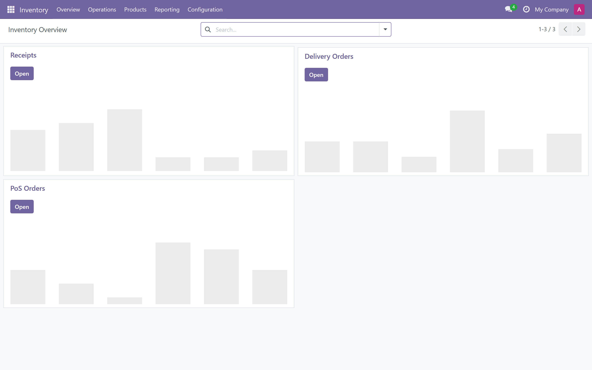
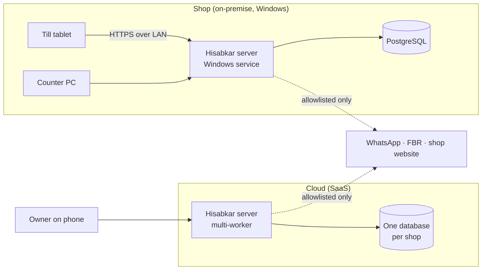

<div align="center">

# Hisabkar

<b>حسابکار</b> · the one who keeps the accounts

**Your one place to manage your entire business.**

Retail ERP and point of sale for Pakistani shops. Pet retail is the first vertical.
Built to run on a shop's own Windows PC with no internet, or in the cloud.


</div>

<br>

<p align="center">
  
</p>
<p align="center"><sub>
Inventory overview on today's development build (empty database). This is still the stock interface:
the Hisabkar design system (P0-4) and rebrand (P0-R, P0-5) come next.
</sub></p>

---

## Why it exists

The pet shops of Bank Square Market, Lahore, still run on paper. Sales go in a hand-written register.
Stock is a guess, and expiry is discovered by customers. Udhaar lives in notebooks. Online orders sit in
four different apps. Hisabkar replaces the register, the stock room and the khata notebook with one
book that keeps working through load-shedding.

| The shop's problem | What Hisabkar does |
|---|---|
| Hand-written register | Fast offline POS, barcode or search, receipts, day close (Z-report) |
| Unknown stock | Stock ledger, low-stock alerts, reorder suggestions |
| Expired products sold | Batch and expiry tracking, earliest-expiry-first at the till, near-expiry alerts |
| Udhaar in notebooks | Customer khata with balances, statements, WhatsApp reminders |
| Supplier dues forgotten | Supplier ledger, purchase bills, payables ageing |
| Loose pet food | Sell 2.5 kg from a 15 kg bag, stock kept exact in kg |
| Pet business specifics | Pet profiles, live animals, grooming and boarding *(Phase 2)* |

## What makes it different

- **Your data stays yours.** Nothing is sent to the platform vendor or to any unlisted third party.
  This is enforced in code, tested, and covered by a firewall layer ([ADR-0005](docs/adr/0005-zero-egress-no-data-to-odoo.md)).
- **Works without internet.** It installs on the shop's own Windows PC, and tablets sell over the
  shop network. Cloud shops get an offline-capable till.
- **Urdu is first-class.** Every screen ships in English and Urdu, right-to-left included.
- **Made for the counter.** POS first, 44 px touch targets, tabular numbers, and keyboard shortcuts
  for a cheap PC.

## Progress

| Phase | Scope | State |
|---|---|---|
| **0 · Foundation** | Name, platform, dev environment, privacy, tooling, design system, rebrand, Urdu, deployment spikes | **2 of 10 tasks done**, a third (privacy) in its final soak check |
| 1 · Retire the register | POS, stock, batches and expiry, khata, purchasing, expenses, reports | Planned (17 tasks) |
| 2 · Channels + Pet pack | WhatsApp, WooCommerce/Shopify, pets, grooming, boarding, multi-branch | Planned |
| 3 · Scale | Couriers, payments, FBR, self-serve SaaS | Planned |

The live resume point, with evidence for each claim, is in **[docs/STATUS.md](docs/STATUS.md)**.

## Architecture



Hisabkar is a set of modules (`addons/hisabkar_*`) on a pinned open-source ERP core. Upstream code
is fetched at exact commits into `vendor/` and never edited by hand. Our behaviour lives in our
modules, and a scripted rebrand produces the final fork ([ADR-0006](docs/adr/0006-hard-fork-with-scripted-rebrand.md)).

## Quick start (Windows)

Prerequisites: Git, [uv](https://docs.astral.sh/uv/), and PostgreSQL 12 or newer running locally.

```powershell
git clone https://github.com/harisizm/pet-store-erp.git
cd pet-store-erp

# Fetch pinned upstream, build .venv (Python 3.12), write odoo.conf, create the DB role
# (asks for the postgres superuser password once).
powershell -ExecutionPolicy Bypass -File scripts\setup-dev.ps1 -CreateDbRole

# Create a development database with the core modules and Hisabkar's privacy module.
.venv\Scripts\python vendor\odoo\odoo-bin -c odoo.conf -d hisabkar_dev `
  -i point_of_sale,stock,purchase,account,product_expiry,pos_hr,l10n_pk,contacts,hisabkar_privacy `
  --without-demo=all --stop-after-init

# Run it, then open http://localhost:8069  (login admin / admin, change it).
.venv\Scripts\python vendor\odoo\odoo-bin -c odoo.conf
```

Testing, Git Bash caveats and browser tests are covered in [AGENTS.md §6](AGENTS.md#6-commands-windows-powershell-from-the-repo-root).

## Repository map

```
addons/                 Hisabkar's own modules (all product code lives here)
  hisabkar_privacy/     zero egress: guard, IAP removal, CSP, tests
docs/                   specs 00–13, ADRs, status, upstream patch log
  STATUS.md             where we are and what to do next
scripts/setup-dev.ps1   reproducible Windows dev setup
repos.json              upstream repos pinned to exact commits
AGENTS.md, CLAUDE.md    rules for the AI agents that build this
LESSONS.md              what those agents learned the hard way
```

## Documentation

| Read | For |
|---|---|
| [Business case](docs/01-business-case.md) · [PRD](docs/02-prd.md) | Why, who, and what success means |
| [Requirements (SRS)](docs/03-srs.md) | Every requirement, with IDs. The source of truth. |
| [Data model](docs/05-data-model.md) · [API](docs/06-api-spec.md) · [Integrations](docs/07-integrations.md) | How the SRS maps onto the platform |
| [Security & compliance](docs/09-security-and-compliance.md) | Data inventory, zero egress, licensing |
| [Roadmap](docs/11-roadmap-and-agent-tasks.md) | Agent-sized tasks, Phase 0 to 3 |
| [Decisions (ADRs)](docs/adr/README.md) | Why the platform, the licensing and the privacy model are what they are |

## How it is built

Development is agent-driven, with guardrails a human can audit:

- **[AGENTS.md](AGENTS.md):** the task loop, design rules and commands every coding agent follows.
- **[docs/AGENTS.md](docs/AGENTS.md):** non-negotiable engineering rules and the Definition of Done.
- **[LESSONS.md](LESSONS.md):** a self-correcting log. Mistakes become lessons, and repeated lessons
  become rules.
- **Independent review:** every change goes through `dod-reviewer`, and every UI change through
  `design-critic`, before it counts as done.

## Licence and attribution

Hisabkar's business modules are proprietary. Modules that integrate community AGPL-3 add-ons are
published under AGPL-3 ([ADR-0004](docs/adr/0004-licensing-proprietary-core-agpl-glue.md)).
The ERP core underneath is Odoo 18 Community Edition, © Odoo S.A., licensed under LGPL-3. Its
licence and copyright notices are kept intact in the source, as the licence requires.
